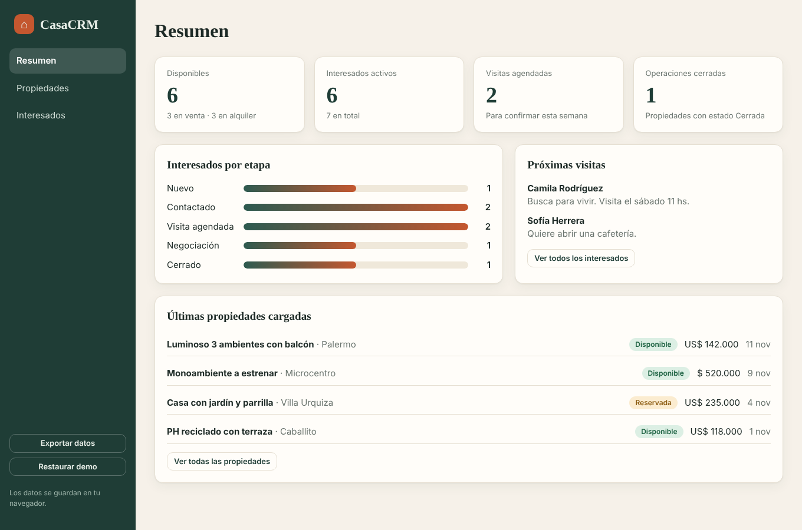
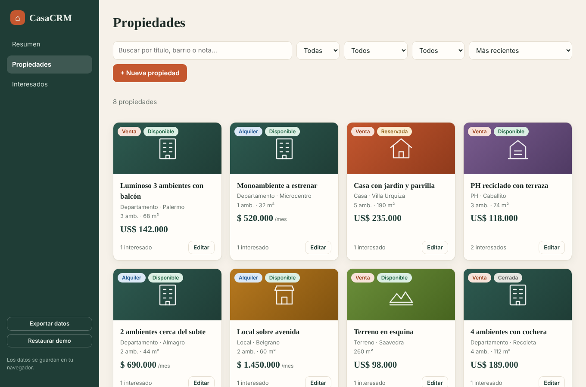
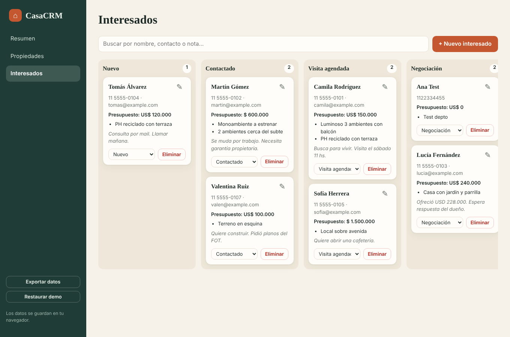

# CasaCRM

CRM simple para una inmobiliaria: el agente carga propiedades (venta o alquiler), registra a las personas interesadas, las vincula con las propiedades que consultaron y las mueve por un pipeline de etapas.





## Funciones
- **Propiedades**: alta, edición y baja con validación; búsqueda por texto; filtros por operación, tipo y estado; orden por fecha, precio o superficie; ficha de detalle con la lista de interesados.
- **Interesados**: pipeline de 5 etapas (Nuevo → Cerrado), cambio de etapa, notas, presupuesto y vínculo con varias propiedades.
- **Resumen**: métricas y gráfico de barras calculados a partir de los datos.
- Persistencia en `localStorage`, exportación a JSON y botón para restaurar datos de ejemplo (todos ficticios).
- Formato de moneda y fechas es-AR (`Intl`), modales accesibles (Escape, `role="dialog"`), diseño responsive.

## Stack
React 19 + Vite. Sin librerías de UI ni de estado: todo el estado vive en un `useReducer`.

## Correr el proyecto
```bash
npm install
npm run dev      # desarrollo
npm run build    # producción en /dist
```
Para publicarlo: subir el repo a GitHub, activar *Settings → Pages → Source: GitHub Actions*; el workflow incluido hace el deploy.

## Transparencia
Lo desarrollé con asistencia de IA (Claude). Las decisiones de modelo de datos, las reglas del reducer y los flujos fueron revisadas y las puedo explicar; ver [NOTAS-ENTREVISTA.md](NOTAS-ENTREVISTA.md).


**Demo en vivo:** https://anshedevz.github.io/casacrm/
